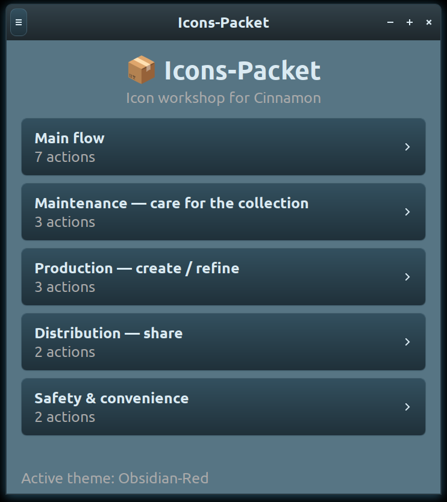
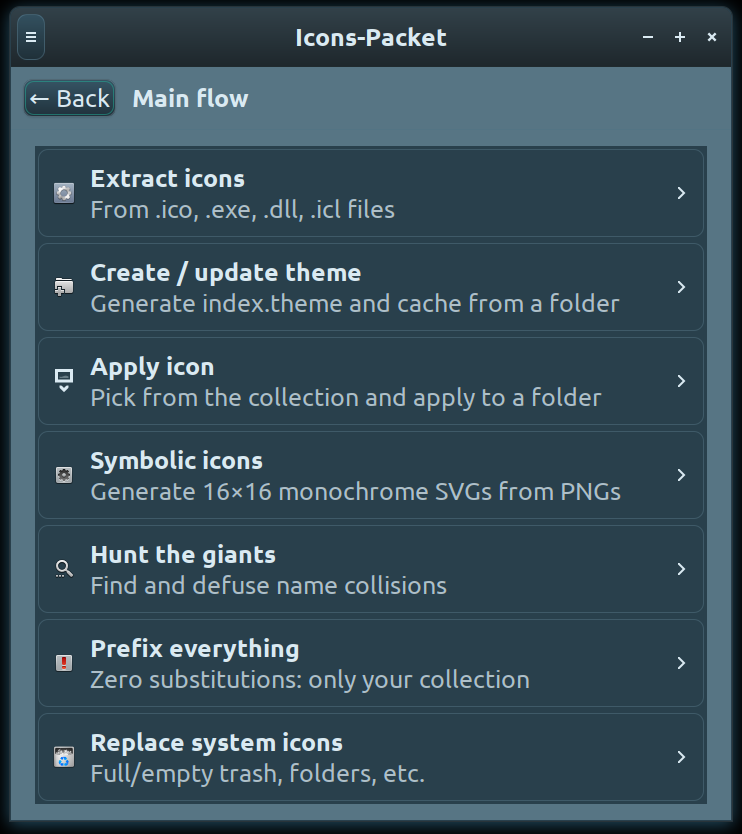

# byBias-Icons-Packet 📦

   [](https://gitlab.com/FranzBias/byBias-Icons-Paket)
  [](https://www.paypal.com/donate/?hosted_button_id=HUF5MYDG465RY)


<p align="center">
  
  
</p>

**تطبيق GTK موحّد لإدارة مجموعة أيقونات شخصية على Linux Mint / Cinnamon.**

🇬🇧 [README-EN.md](README-EN.md) · 🇮🇹 [README-IT.md](README-IT.md) · 🇩🇪 [README-DE.md](README-DE.md) · 🇪🇸 [README-ES.md](README-ES.md) · 🇫🇷 [README-FR.md](README-FR.md) · 🇳🇱 [README-NL.md](README-NL.md) · 🇷🇺 [README-RU.md](README-RU.md) · 🇸🇦 [README-AR.md](README-AR.md) · 🇨🇳 [README-ZH.md](README-ZH.md) · 🇯🇵 [README-JA.md](README-JA.md)

---

## 💛 لحظة صدق

> منذ عدة أشهر أمرّ بفترة صعبة: عدد قليل من المهام، والقليل منها لا
> يدرّ دخلًا كافيًا. إن لم يتغيّر الوضع قريبًا، سأضطر للبحث عن عمل في
> مكان آخر — لا ضير في ذلك، لكنني أفضّل بكثير الاستمرار في بناء مشاريع
> مثل هذا.
>
> إذا كان **byBias-Icons-Packet** مفيدًا لك وترغب في دعمه، فإن التبرع —
> حتى ولو بيورو واحد — يُحدث فرقًا حقيقيًا إذا شارك فيه عدد كافٍ من
> الناس. وإذا لم تستطع التبرع، فإن **نشر الخبر** يساعد بنفس القدر تقريبًا.
> شكرًا من القلب، على أي حال، لوصولك إلى هنا في القراءة. 🙏

---

يجمع **byBias-Icons-Packet** مجموعة أدوات أيقونات byBias بالكامل في
تطبيق GTK3 واحد، صُمّم لإدارة مجموعتك الخاصة من الأيقونات: استخراجها
وتنظيفها وتسميتها بشكل متسق وتحويلها إلى سمة. وسمة أيقونات حرّة (GPL-3)
مصنوعة بالتطبيق قيد الإعداد. النافذة الرئيسية لوحة
تحكم: كل إجراء بطاقة مرئية، والنقر عليها يفتح لوحته في النافذة نفسها —
دون الحاجة للبحث في القوائم أو حفظ الأوامر عن ظهر قلب.

## الإجراءات

يغطي **التدفق الرئيسي** العمل اليومي لبناء سمة أيقونات وصيانتها من
البداية إلى النهاية:

- **استخراج الأيقونات** — يستخرج الأيقونات من ملفات `.ico` و`.exe`
  و`.dll` و`.icl` (حتى المعاد تسميتها لتبدو شيئًا آخر)، مع إعادة بناء
  صور PNG نظيفة مع الحفاظ على الشفافية. مفيد عندما تكون حزمة أيقونات
  تم تنزيلها في الواقع ملفًا تنفيذيًا لنظام Windows متنكرًا.
- **إنشاء / تحديث سمة** — ينسخ مجلدًا مصدرًا إلى سمة أيقونات حقيقية:
  ينظّف أسماء الملفات والمجلدات (مسافات/شرطات سفلية ← شرطة، وإزالة
  التشكيل)، وينشئ `index.theme` صحيحًا ويعيد بناء الذاكرة المؤقتة،
  ويمكنه تفعيل السمة على مستوى النظام بالكامل بنقرة واحدة.
- **تطبيق أيقونة** — محدد منظّم وفق فئاتك *الخاصة* (وليس فئات النظام
  العامة) يتيح لك تصفح المجموعة بصريًا وتطبيق أي أيقونة على مجلد.
- **أيقونات رمزية** — يحوّل صورة PNG ملونة إلى أيقونة SVG رمزية أحادية
  اللون بحجم 16×16، من النوع المستخدم في اللوحات والقوائم التي تغيّر
  لونها تلقائيًا لتناسب السمات الفاتحة أو الداكنة.
- **مطاردة العمالقة** — يبحث عن تعارضات الأسماء بين أيقوناتك وأيقونات
  النظام؛ يُعد التعارض السبب الكلاسيكي لظهور الأيقونات فجأة بحجم عملاق،
  أو كمثلثات صورة معطوبة.
- **بادئة للكل** — الخيار الآمن الذي لا يتطلب إشرافًا: يضيف بادئة
  `bybias-` إلى كل أيقونة في السمة بحيث لا يمكن لأي منها أن تحل محل
  أيقونة نظام عن طريق الخطأ أبدًا.
- **استبدال أيقونات النظام** — اختر خانة نظام (سلة مهملات ممتلئة/فارغة،
  مجلد عام، مجلد الصفحة الرئيسية، وغيرها) وصورة خاصة بك: يتم تثبيتها
  بالاسم القياسي الدقيق، لتحل محل تلك الأيقونة في كل مكان تظهر فيه على
  سطح المكتب.
- **النقر بزر الفأرة الأيمن في Nemo** — *تغيير الأيقونة…* يفتح مجموعتك ويطبّق الأيقونة على المجلد أو الملف المحدد؛ و*لصق أيقونة* يستخدم الصورة الموجودة في الحافظة. يثبّتهما `install.sh` (اضغط F5 في Nemo لرؤية الأيقونة الجديدة).

بالإضافة إلى التدفق الرئيسي، تجمع لوحة التحكم أدوات أكثر تخصصًا في أربعة
أقسام، كل منها مصمم لحل نوع معين من الصداع:

**الصيانة** — الحفاظ على تنظيم مجموعة كبيرة مع مرور الوقت.
- *العثور على التكرارات* يقارن الأيقونات حسب المحتوى الفعلي للصورة
  (بصمة تجزئة للبكسلات)، لا حسب اسم الملف، فيكتشف بذلك نفس الأيقونة
  المحفوظة مرتين بأسماء مختلفة.
- *ورقة التلامس* تعرض المجموعة بأكملها كفسيفساء PNG واحدة موسومة —
  طريقة مفيدة حقًا لرؤية ما تملكه فعليًا بدلاً من النقر على المجلدات
  واحدًا تلو الآخر.
- *العثور على المشابه* يأخذ أيقونة مرجعية ويرتب باقي المجموعة حسب مدى
  قرب لونها السائد، وهو مفيد لبناء مجموعة فرعية متجانسة بصريًا.

**الإنتاج** — تشكيل الأيقونات للاستخدام الفعلي.
- *توحيد الأحجام* يأخذ صورة PNG مصدرية كبيرة الحجم وينشئ المجموعة
  الكاملة من الأحجام القياسية (من 16 إلى 256 بكسل)، بتحجيم صحيح بدلاً
  من ترك النظام يقوم بتحجيمها بشكل رديء أثناء العرض.
- *إعادة التلوين / العكس* يطبّق درجة لون مختارة على الأيقونات أحادية
  اللون، أو يعكس الفاتح والداكن، بحيث يمكن تكييف مجموعة رمزية مع السمة
  المعاكسة.
- *القص والتوسيط* يزيل الهوامش الشفافة غير المتساوية ويعيد توسيط
  الأيقونة بحشو متسق — الحل لمجموعة مختلطة تبدو "غير متوازنة" قليلاً
  دون سبب واضح.

**التوزيع** — مشاركة ما قمت ببنائه.
- *تصدير الحزمة* يضغط السمة مع ملفي `LICENSE` و`README` منشأين
  تلقائيًا، جاهزة للنشر.
- *إنشاء عرض توضيحي* يبني صورة ترويجية من مجموعة مختارة من الأيقونات،
  من النوع الذي قد تريده على صفحة تنزيل.

**الأمان والراحة** — شبكة الأمان.
- *النسخ الاحتياطي / الاستعادة* يأخذ لقطة مؤرخة من السمة قبل إجراء
  تغيير محفوف بالمخاطر، مع طريقة للعودة بنقرة واحدة إذا ساءت الأمور.
- *فحص الحالة* يمرّر السمة بأكملها عبر قائمة تحقق تشخيصية (الوراثة،
  الأسماء المشكّلة، التعارضات، صلاحية الذاكرة المؤقتة) ويشير إلى
  المشكلات *قبل* أن تتحول إلى أيقونات عملاقة أو مثلثات صورة معطوبة.

توفر قائمة في أعلى يسار النافذة (☰) وصولًا سريعًا إلى قسم **حول
البرنامج** (بما في ذلك رابط GitHub)، و**محدد لغة** يغطي جميع اللغات
العشر لهذا الملف، ومفتاح تبديل **السمة الفاتحة/الداكنة** للتطبيق نفسه.

## المتطلبات

```bash
sudo apt install python3-gi gir1.2-gtk-3.0 gir1.2-xapp-1.0 python3-pil icoutils python3-icoextract
```

عند التشغيل الأول، إذا كانت هناك تبعية مفقودة، يكتشف byBias-Icons-Packet
ذلك، ويسرد بالضبط ما هو مطلوب، ويطلب موافقتك الصريحة، ويثبّته عبر
المصادقة الرسومية الخاصة بالنظام (pkexec) أو sudo — لذا يمكنك أيضًا
تشغيله فقط وتركه يهيئ نفسه. كلمة مرورك يديرها النظام دائمًا، وليس
التطبيق أبدًا.

## التشغيل

```bash
python3 icons-packet
```

**البنية** — يحتوي `icons_packet_core.py` على كل المنطق (دون GTK، قابل
للاختبار بشكل مستقل)؛ `icons_packet_gui.py` هو لوحة تحكم GTK3؛
`icons-packet` هو المشغّل، الذي يتولى أيضًا فحص التبعيات الموصوف
أعلاه.

**قاعدة تسمية الملفات** — تستخدم أسماء الملفات والمجلدات الشرطات فقط
(`-`)، ولا تستخدم أبدًا المسافات أو الشرطات السفلية؛ يحوّل التطبيق
كليهما تلقائيًا في كل مرة يتعامل فيها مع سمة.

## شكر وتقدير

يقف Icons-Packet على أكتاف هذه المشاريع الحرة — شكرًا لها:

- [icoextract](https://github.com/jlu5/icoextract) — James Lu — استخراج احتياطي، حتى من ملفات ‎.mun في Windows 10 وما بعده (MIT)
- [icoutils](https://www.nongnu.org/icoutils/) (`wrestool`) — استخراج الأيقونات من ‎.exe/.dll (GPL-3.0+)
- [Pillow](https://python-pillow.org/) — معالجة الصور (MIT-CMU)
- [PyGObject](https://pygobject.gnome.org/) + GTK 3 — الواجهة (LGPL-2.1+)
- [XApp](https://github.com/linuxmint/xapp) — Linux Mint — أداة اختيار الأيقونات (LGPL-3.0)

## 🌱 الخطأ إنساني

بُني هذا المشروع بسرعة، من قبل شخص واحد، في وقت فراغه — لذا من المحتمل
جدًا أن يحتوي على بعض العيوب: خطأ برمجي، سلوك غريب، نص مترجم بشكل
خاطئ، جملة غير دقيقة في هذا الملف نفسه. إذا لاحظت أي شيء، يرجى
فتح issue — بلاغات الأخطاء، وتصحيحات اللغة، وأوجه
عدم الدقة العامة، جميعها موضع ترحيب صادق. وينطبق الأمر نفسه على
**طلبات الميزات**: إذا كان هناك شيء تتمنى أن يفعله التطبيق، أو يفعله
بشكل مختلف، فقل ذلك بلا تردد. الاقتراحات هي التي تحدد وجهة هذا المشروع
من الآن فصاعدًا.

---

*صُنع بـ ❤️ بواسطة FranzBias — [github.com/FranzBias/byBias-Icons-Paket](https://github.com/FranzBias/byBias-Icons-Paket)*
